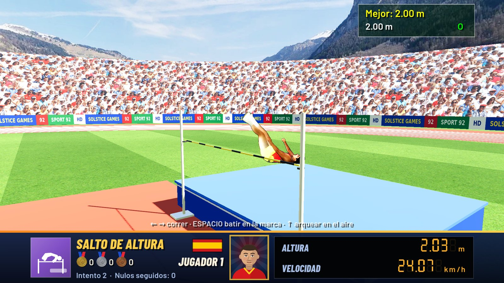
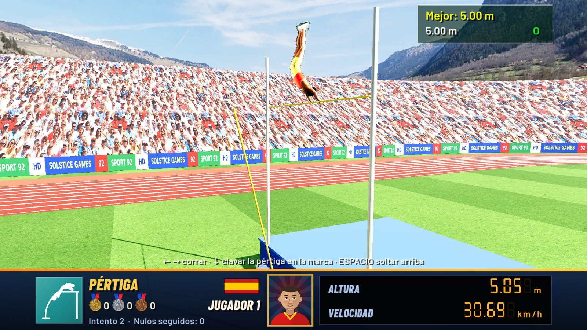
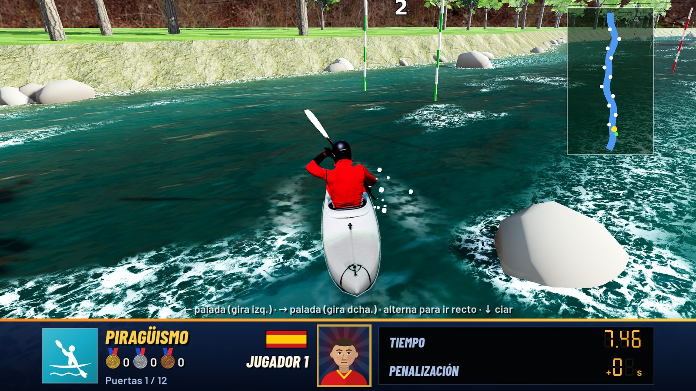

# Solstice Games

Juego de atletismo de verano en 3D, **gratis**, para Windows. Ocho pruebas, de 1 a 4 jugadores, inspirado en los clásicos de atletismo de PC de principios de los 90. Hecho con Godot 4.7.

## Descargar

**[⬇ Descargar la última versión para Windows](https://github.com/jegalgar/solstice-games/releases/latest)**

1. En la página de la release, baja `SolsticeGames_Windows.zip`.
2. Descomprímelo y ejecuta `SolsticeGames.exe`. No necesita instalación.

Requisitos: Windows 10 u 11 de 64 bits y una tarjeta gráfica con soporte de Vulkan u OpenGL 3.3.

> Windows puede mostrar el aviso «SmartScreen» porque el programa no está firmado digitalmente. Pulsa *Más información → Ejecutar de todas formas*.
> Puedes comprobar la descarga con la suma SHA-256 que aparece en la release (`SHA256.txt`).

## Las ocho pruebas

| Prueba | Cómo se juega |
|---|---|
| Tiro con arco | Apunta con las flechas, mantén ESPACIO para tensar y suelta para disparar. Cuenta el viento. |
| Hípica | ↑ ↓ cambian el aire y ESPACIO salta. Derribo, agua o rehúse suman 4 faltas. |
| 400 m vallas | Alterna ← → para correr y ESPACIO para saltar. |
| Jabalina | Alterna ← →, mantén ESPACIO para fijar el ángulo y suelta para lanzar. |
| Salto de altura | ← → para correr, ESPACIO para batir y ↑ para arquear sobre el listón. |
| Pértiga | ← → para correr, ↓ para clavar la pértiga y ESPACIO para soltarla arriba. |
| Ciclismo (1 km) | Alterna ← → para pedalear; ↑ ↓ para cambiar de marcha. |
| Piragüismo (eslalon) | ← y → dan paladas y giran el kayak; ↓ para ciar. |

## Modos

- **Competición**: las 8 pruebas seguidas contra la CPU, con puntos, medallas y clasificación.
- **Prueba individual**: una prueba suelta para practicar.
- De **1 a 4 jugadores** por turnos, 16 países y tres niveles de dificultad.
- Teclado, mando o ratón en los menús. **F11** o **Alt+Enter**: pantalla completa.

## Capturas

## Licencia y créditos

Solstice Games es **freeware**: puedes jugarlo y compartirlo gratis, sin modificarlo y sin venderlo. Los atletas están generados con IA y no representan a personas reales. Los recursos de terceros (cielos y materiales CC0, tipografías, motor Godot) están detallados en [CREDITOS.md](CREDITOS.md).
